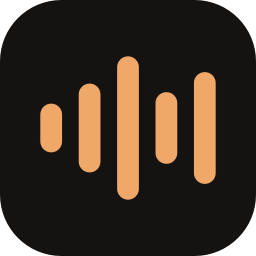
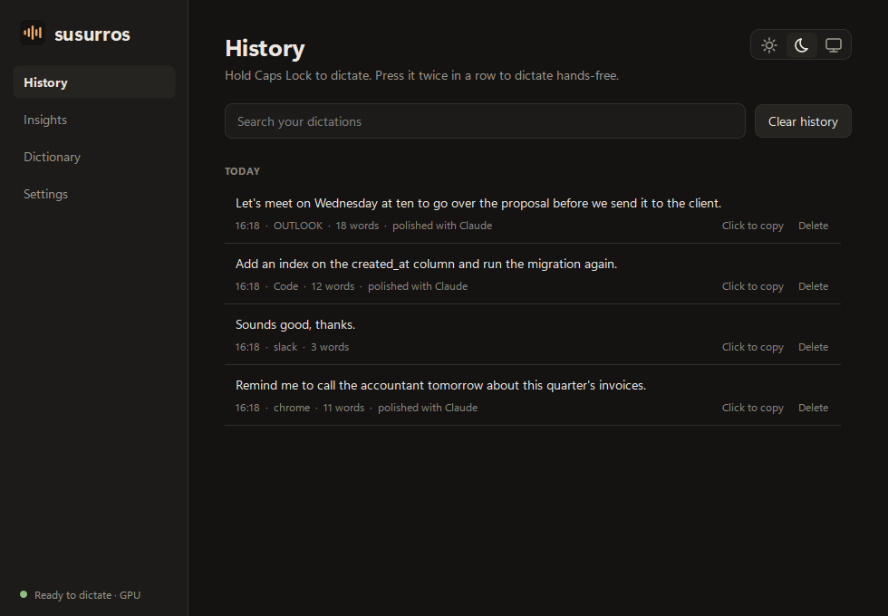
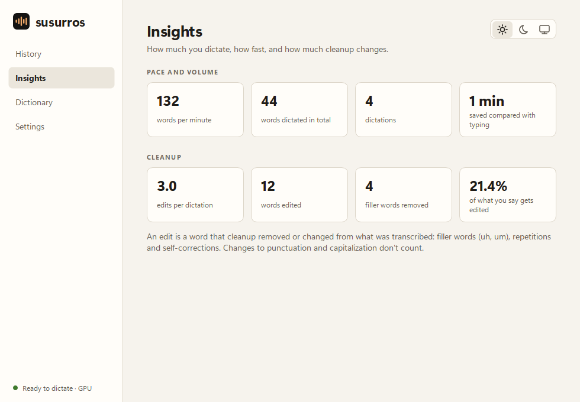
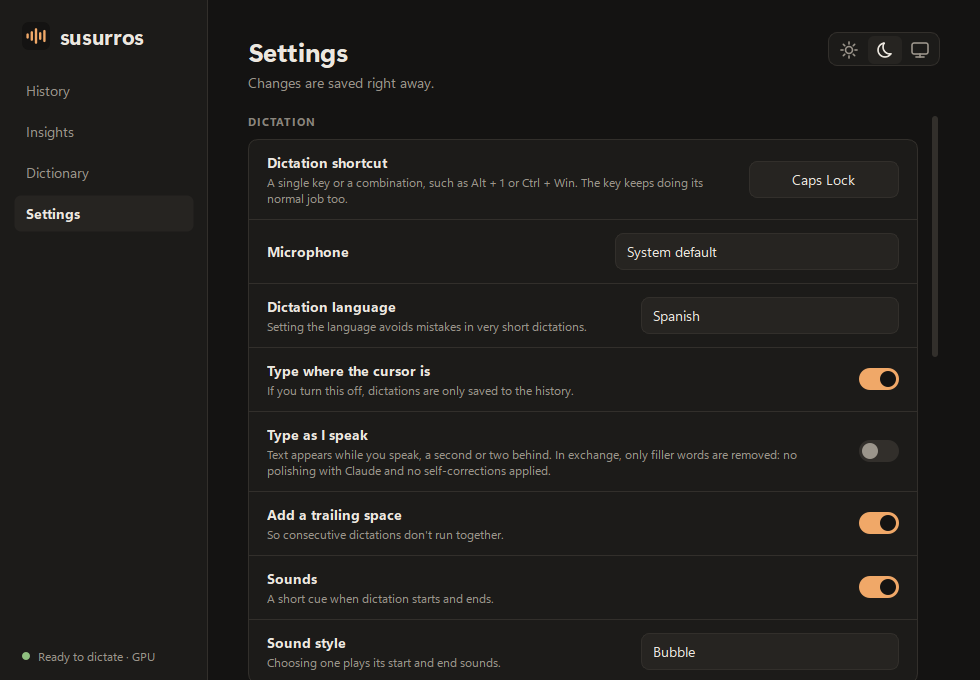

<div align="center">



# Susurros

**Talk instead of typing.** Hold a key, speak, and your words appear wherever your cursor is.

Free, open source, and your voice never leaves your computer.

[](#-install-on-windows)
[](#-install-on-macos)



</div>

## ✨ How it works

| 1. Hold the key | 2. Speak | 3. Let go |
|:---:|:---:|:---:|
|  |  | 📝 |
| **Caps Lock** on Windows<br>**Right Command** on a Mac | Say it the way you would say it out loud | The text is typed for you, in any app |

That is all there is to it. It works in your email, your browser, your chat apps, your code editor: anywhere you can type.

## 💡 What makes it nice

- 🧹 **It tidies up what you say.** "Um", "uh", repeated words and false starts are removed, so the text reads the way you meant it.
- 🙌 **Hands-free mode.** Tap the key twice and keep talking for as long as you like. Tap twice again to finish.
- 🔒 **Private.** Your voice is turned into text on your own computer. No audio is saved or uploaded.
- 📚 **It remembers.** Every dictation is kept in a history you can search and copy from with one click.
- 📖 **It learns your words.** Add names, brands or jargon to the dictionary and they are spelled right.
- ⚡ **Live typing.** Optionally, the text appears while you are still speaking.
- 🎨 **Yours to adjust.** Pick the key, the sounds, a light or dark look, and where the little indicator sits on screen.
- 🌍 **English and Spanish** interface. Dictation works in many languages.

<div align="center">


</div>

## 🪟 Install on Windows

1. Open the **Start** menu, type **PowerShell** and press Enter.
2. Paste this line and press Enter:

   ```powershell
   irm https://raw.githubusercontent.com/KTJota/susurros/main/scripts/get.ps1 | iex
   ```

3. When it finishes, open **Susurros** from the Start menu.

The first time, it downloads everything it needs, including the speech model, so give it a few minutes. To update later, run the same line again.

> Works on Windows 10 and 11. It is fastest with an NVIDIA graphics card, and works without one too.

## 🍎 Install on macOS

1. **[Download Susurros for Mac](https://github.com/KTJota/susurros/releases/download/v0.2.0-macos/Susurros-0.2.0-macos-arm64.dmg)**, open the file and drag **Susurros** into **Applications**.
2. Open Susurros. macOS will say it cannot check the app. Close that message, open **System Settings › Privacy & Security**, scroll down and click **Open Anyway**. You only do this once.
3. Say yes to the two permissions it asks for: **Microphone** (to hear you) and **Accessibility** (to type the text for you).

> For Macs with Apple Silicon (M1 or newer) and macOS 14 or later. The Mac version is new: if something does not work, [tell us](https://github.com/KTJota/susurros/issues).

## ⌨️ Using it

| You do | Susurros does |
|---|---|
| **Hold** the key and speak | Records while you hold; types the text when you let go |
| **Tap twice** quickly | Starts hands-free dictation; tap twice again to finish |
| Press **Esc** | Cancels the dictation |
| Click a dictation in the history | Copies it |

<div align="center">
&nbsp;&nbsp;&nbsp;

<br><sub>The small indicator shows when Susurros is listening. Drag it to any edge of the screen.</sub>
</div>

## ❓ Questions

**Is it really free?**
Yes. There is no account, no subscription and no limit.

**Does it need the internet?**
Only to download the speech model the first time. After that, dictation works offline.

**Where does my voice go?**
Nowhere. The audio is turned into text on your computer and then discarded. Your history is a file on your computer that only you can see.

**What is the "Claude" option in Settings?**
An optional extra polish for your text. If you add your own Anthropic API key, the already transcribed *text* (never the audio) is sent to Claude to fix punctuation and wording. Without a key, nothing is sent anywhere.

**Why does my Mac warn me about the app?**
Apple charges developers a yearly fee to remove that warning, and this is a free project. The app is open source, so anyone can check what it does.

**Can I use Caps Lock on a Mac?**
No: macOS does not tell apps when Caps Lock is held and released. Any other key or combination works; choose yours in Settings.

## 🛠️ For developers

<details>
<summary>Build it yourself, run the tests, publish a release</summary>

<br>

Susurros is written in Python with PySide6. Speech recognition is Whisper `large-v3-turbo`: [faster-whisper](https://github.com/SYSTRAN/faster-whisper) on Windows (CUDA or CPU) and [mlx-whisper](https://github.com/ml-explore/mlx-examples/tree/main/whisper) on Apple Silicon.

```sh
uv sync
uv run pytest
```

The Windows-specific code (keyboard hook, text injection, sounds, start with Windows) lives in the modules at the top of `src/susurros`. The macOS counterparts are in `src/susurros/mac` and are only imported on a Mac.

**Install from a clone on Windows:** `powershell -ExecutionPolicy Bypass -File scripts\install.ps1`

**Build the Mac app** on an Apple Silicon Mac: `sh packaging/macos/build.sh`

**Data folder:** `%APPDATA%\Susurros` on Windows, `~/Library/Application Support/Susurros` on macOS.

**Publishing a version.** Each version is two GitHub releases, one per system.

1. Set the version in `pyproject.toml` and in the Mac download link above, run `uv lock` and push.
2. Run the **Build** workflow (`gh workflow run build.yml`). It runs the tests on Windows and macOS, builds the Windows zip and the Mac disk image, and checks that the packaged Mac app starts and transcribes.
3. Publish both releases from that run: `sh scripts/publish-release.sh RUN_ID`.

</details>

## 📄 License

[MIT](LICENSE). Use it, change it, share it.
